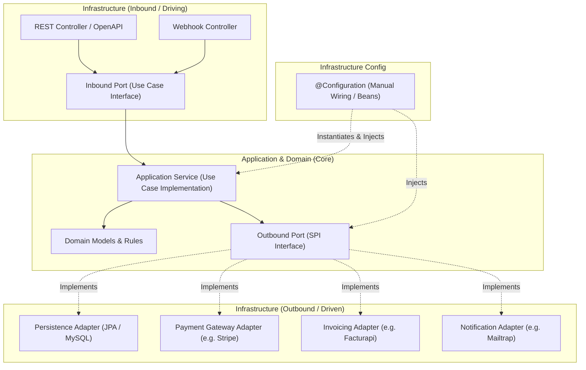

# Guía de Arquitectura Hexagonal (Ports and Adapters)

Este proyecto implementa **Arquitectura Hexagonal** (también conocida como *Puertos y Adaptadores* o *Clean Architecture*), diseñada para mantener el núcleo del negocio desacoplado de frameworks, bases de datos, librerías y proveedores externos.

---

## 1. Diagrama de Flujo y Dependencias



> **Regla de Dependencia Fundamental:**  
> Las dependencias siempre apuntan hacia adentro.  
> `Infrastructure -> Application -> Domain`.  
> El **Dominio** no depende de nada. La **Aplicación** solo depende del Dominio.

---

## 2. Estructura de Carpetas

```text
src/main/java/org/angel/paymentclean/
│
├── domain/                                  # NÚCLEO DE NEGOCIO (100% puro Java, sin frameworks)
│   ├── model/                               # Entidades, Value Objects, Enums (e.g. Payment, Money, PaymentStatus)
│   ├── exception/                           # Excepciones de negocio (e.g. InvalidAmountException)
│   └── event/                               # Eventos de dominio (e.g. PaymentCompletedEvent)
│
├── application/                             # CASOS DE USO Y ORQUESTACIÓN
│   ├── ports/
│   │   ├── in/                              # Driving Ports: Interfaces de lo que el sistema hace (e.g. ProcessPaymentUseCase)
│   │   └── out/                             # Driven Ports: Interfaces de lo que el sistema necesita (e.g. PaymentGatewayPort, InvoicePort)
│   └── service/                             # Implementaciones de los casos de uso (POJOs puros)
│
├── infrastructure/                          # TECNOLOGÍAS, FRAMEWORKS Y ADAPTADORES
│   ├── adapters/
│   │   ├── in/                              # Adaptadores Primarios (Driving)
│   │   │   ├── rest/                        # Controladores HTTP (@RestController)
│   │   │   │   ├── dto/                     # Request/Response DTOs con validaciones
│   │   │   │   └── mapper/                  # Mapeo DTO <-> Comandos/Modelos
│   │   │   └── webhook/                     # Endpoints para recibir eventos externos
│   │   │
│   │   └── out/                             # Adaptadores Secundarios (Driven)
│   │       ├── persistence/                 # Base de Datos (MySQL / JPA)
│   │       │   ├── entity/                  # Entidades JPA (@Entity)
│   │       │   ├── repository/              # Spring Data JPA Repositories
│   │       │   └── mapper/                  # Mapeo JPA Entity <-> Domain Model
│   │       ├── external/                    # APIs y Clientes externos (e.g. Stripe, Facturapi)
│   │       └── notification/                # Servicios de mensajería/email (e.g. Mailtrap)
│   │
│   └── config/                              # Configuración de Spring (@Configuration, cableado de Beans, OpenAPI)
│
└── shared/                                  # Componentes compartidos o utilidades transversales
    └── domain/                              # Clases base de dominio (e.g. AggregateRoot, ValueObject)
```

---

## 3. Responsabilidades por Capa

### A. Capa de Dominio (`domain`)
* **Qué contiene:** Entidades con identidad, Value Objects inmutables, invariantes de negocio y excepciones de dominio.
* **Regla estricta:** Ninguna anotación de Spring (`@Component`, `@Service`), JPA (`@Entity`, `@Table`) ni librerías de serialización (`@JsonProperty`). Solo Java estándar.

### B. Capa de Aplicación (`application`)
* **Puertos de Entrada (`ports.in`):** Interfaces que declaran los casos de uso del sistema y objetos de comando/consulta si aplican.
* **Puertos de Salida (`ports.out`):** Interfaces SPI que definen contratos para persistir datos, procesar transacciones, generar facturas o enviar notificaciones.
* **Servicios (`service`):** Clases que implementan los puertos de entrada. Orquestan el flujo invocando métodos del dominio y puertos de salida.

### C. Capa de Infraestructura (`infrastructure`)
* **Adaptadores de Entrada (`adapters.in`):** Reciben peticiones externas (HTTP REST, Webhooks), validan formatos y llaman a los casos de uso.
* **Adaptadores de Salida (`adapters.out`):** Implementan los puertos de salida usando librerías y tecnologías concretas (Spring Data JPA, SDK de Stripe, Facturapi, Mailtrap, etc.).
* **Configuración (`config`):** Contiene las clases `@Configuration` donde se instancian manualmente los servicios de aplicación como `@Bean`, inyectándoles los adaptadores de salida correspondientes.

---

## 4. Configuración Manual (Spring Bean Wiring)

Para mantener los servicios de aplicación como POJOs limpios sin anotaciones de Spring, se configuran manualmente en `infrastructure.config`:

```java
@Configuration
public class PaymentConfig {

    @Bean
    public ProcessPaymentUseCase processPaymentUseCase(
            PaymentRepositoryPort paymentRepository,
            PaymentGatewayPort paymentGateway,
            InvoicePort invoicePort,
            NotificationPort notificationPort) {
        return new ProcessPaymentService(paymentRepository, paymentGateway, invoicePort, notificationPort);
    }
}
```

---

## 5. Estrategia de Expansión Futura

1. **Nuevos Proveedores o Tecnologías:**  
   Si en el futuro cambias o agregas otro proveedor (por ejemplo, PayPal junto a Stripe, o SendGrid junto a Mailtrap), solo creas un nuevo adaptador en `infrastructure.adapters.out` implementando el puerto correspondiente, sin modificar una sola línea de lógica de negocio en `domain` ni `application`.
2. **Escalabilidad por Módulos (Bounded Contexts):**  
   Si el proyecto crece significativamente en complejidad funcional, la misma estructura hexagonal se replica por módulo o contexto acotado:
   ```text
   org.angel.paymentclean/
   ├── payment/       (domain, application, infrastructure)
   ├── invoice/       (domain, application, infrastructure)
   ├── customer/      (domain, application, infrastructure)
   └── shared/        (domain, infrastructure)
   ```
